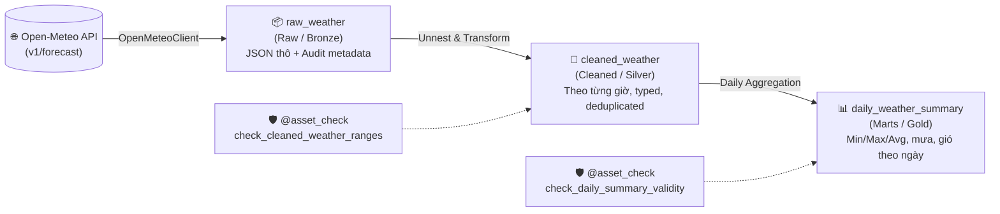

# 🌦️ Weather Dagster Pipeline

Dự án Data Pipeline chuẩn **Software-Defined Assets (SDA)** được xây dựng bằng **Dagster** và **DuckDB**, tự động thu thập, làm sạch và phân tích dữ liệu thời tiết từ mã nguồn mở **Open-Meteo REST API**.

---

## 📌 Điểm nổi bật của dự án

- **Chuẩn kiến trúc SDA (Software-Defined Assets)**: Mô hình Medallion 3 tầng dữ liệu rõ ràng (`raw` ➔ `cleaned` ➔ `marts`).
- **Kho dữ liệu nhúng siêu tốc với DuckDB**: Lưu trữ toàn bộ dữ liệu vào duy nhất file `data/weather.duckdb`, truy vấn phân tích SQL cực nhanh không cần server phức tạp.
- **Quản trị dữ liệu & Kiểm toán chuẩn Enterprise (Data Governance)**:
  - Khóa chính kết hợp đa chiều (`location_name`, `timestamp`) chống ghi đè dữ liệu giữa các địa điểm.
  - Đầy đủ dấu vết nguồn gốc và thời gian: `created_at`, `updated_at`, `source`, `dagster_run_id`.
  - Cơ chế Upsert thông minh (bảo toàn `created_at` ban đầu khi cập nhật bản ghi).
- **Kiểm soát chất lượng dữ liệu tự động (`@asset_check`)**: Tự động xác thực ngưỡng vật lý (nhiệt độ, độ ẩm, lượng mưa) và tính toàn vẹn của dữ liệu.
- **Trực quan hóa trực tiếp trên Web UI**: Xem bảng số liệu Preview ngay trên Dagster UI mà không cần cài thêm công cụ ngoài.
- **Tự động hóa hoàn toàn (Automation)**: Lịch chạy Cron tự động theo múi giờ địa phương (`Asia/Ho_Chi_Minh`).
- **Khả năng kiểm thử độc lập (Testability)**: Chạy toàn bộ test suite với `pytest` mà không cần bật webserver.

---

## 🏗️ Kiến trúc luồng dữ liệu (Data Lineage)



---

## 🗂️ Cấu trúc thư mục

```
weather_dagster/
├── pyproject.toml                     # Cấu hình uv / pip, dependencies và packaging
├── .gitignore                         # Loại bỏ cache, venv và temporary DuckDB files
├── README.md                          # Tài liệu hướng dẫn sử dụng dự án
├── data/
│   └── weather.duckdb                 # File cơ sở dữ liệu DuckDB duy nhất
├── scripts/
│   └── explore_weather.py             # Script CLI truy vấn và phân tích thời tiết nhanh
├── src/
│   └── weather_dagster/
│       ├── __init__.py
│       ├── definitions.py             # Nạp tập trung Definitions (assets, checks, resources, schedules)
│       └── defs/
│           ├── __init__.py
│           ├── assets.py              # Định nghĩa 3 tầng: raw -> cleaned -> marts
│           ├── checks.py              # Các Data Quality Check với @asset_check
│           ├── client.py              # Logic gọi Open-Meteo REST API (tách biệt khỏi asset)
│           ├── resources.py           # Khai báo DuckDBResource kết nối tới weather.duckdb
│           └── schedules.py           # Khai báo lịch chạy định kỳ theo múi giờ
└── tests/
    └── test_pipeline.py               # Chạy kiểm thử pytest độc lập không cần webserver
```

---

## 📊 Mô hình dữ liệu trong DuckDB

### 1. Tầng Raw (`raw_weather`)
Lưu trữ nguyên bản chuỗi JSON từ Open-Meteo để làm bằng chứng kiểm toán (Audit Trail) và bảo toàn tính bất biến (Immutability):
- `raw_id` *(VARCHAR, PK)*: UUID định danh cho từng batch cào.
- `source` *(VARCHAR)*: Nguồn dữ liệu (`"open-meteo"`).
- `location_name` *(VARCHAR)*: Địa điểm thu thập (`"Hanoi"`).
- `latitude`, `longitude` *(DOUBLE)*: Tọa độ địa lý.
- `dagster_run_id` *(VARCHAR)*: Mã Run ID của Dagster thực hiện.
- `created_at` *(TIMESTAMP)*: Thời điểm ghi nhận dữ liệu vào DB.
- `payload` *(VARCHAR)*: Chuỗi JSON thô nguyên bản từ API.

### 2. Tầng Cleaned (`cleaned_weather`)
Bóc tách mảng thời gian thành từng dòng giờ chi tiết, chuẩn hóa kiểu và khử trùng lặp:
- `location_name` *(VARCHAR, PK)*
- `timestamp` *(TIMESTAMP, PK)* ➔ **Khóa chính tổng hợp `(location_name, timestamp)`**.
- `temperature_2m` *(DOUBLE)*: Nhiệt độ (°C).
- `relative_humidity_2m` *(DOUBLE)*: Độ ẩm (%).
- `precipitation` *(DOUBLE)*: Lượng mưa (mm).
- `wind_speed_10m` *(DOUBLE)*: Tốc độ gió (km/h).
- `source`, `latitude`, `longitude`, `dagster_run_id`, `created_at`, `updated_at`.

### 3. Tầng Marts (`daily_weather_summary`)
Bảng tổng hợp phân tích theo ngày (`GROUP BY location_name, date`):
- `location_name` *(VARCHAR, PK)*
- `date` *(DATE, PK)*
- `min_temperature`, `max_temperature`, `avg_temperature`: Nhiệt độ thấp nhất, cao nhất, trung bình (°C).
- `total_precipitation`: Tổng lượng mưa trong cả ngày (mm).
- `avg_wind_speed`: Tốc độ gió trung bình (km/h).
- `record_count`: Số giờ đo trong ngày (24 giờ).
- `dagster_run_id`, `created_at`, `updated_at`.

---

## 🚀 Hướng dẫn cài đặt & Khởi chạy

### 1. Yêu cầu hệ thống
- Khuyến nghị sử dụng **Python 3.12** (để có sẵn pre-built binary wheels cho DuckDB và Dagster).

### 2. Cài đặt môi trường

#### Cách 1: Sử dụng `uv` (Khuyên dùng - Cực nhanh)
```bash
# 1. Tạo venv với Python 3.12
uv venv --python python3.12

# 2. Kích hoạt môi trường ảo
source .venv/bin/activate

# 3. Cài đặt dependencies
uv pip install -e ".[dev]"
```

#### Cách 2: Sử dụng `pip` tiêu chuẩn
```bash
python3.12 -m venv .venv
source .venv/bin/activate
pip install --upgrade pip
pip install -e ".[dev]"
```

---

### 3. Khởi chạy Dagster Webserver (UI)

```bash
dagster dev
```
Mở trình duyệt truy cập: **`http://localhost:3000`**

1. Vào tab **Lineage** hoặc **Catalog** để xem cây đồ thị 3 tầng Asset.
2. Bấm nút **"Materialize all"** ở góc phải trên để cào dữ liệu sống từ Open-Meteo và nạp vào DuckDB.
3. Click vào ô **`daily_weather_summary`** để xem ngay bảng số liệu Preview thời tiết 7 ngày tới.

---

### 4. Chạy kiểm thử tự động (Pytest)

Chạy kiểm thử end-to-end độc lập không cần khởi động webserver:
```bash
pytest
```
*Tất cả 3 bài test sẽ tự động xác minh API client, nạp definitions và kiểm thử chu trình materialization với DuckDB.*

---

### 5. Truy vấn & Khám phá dữ liệu (Data Analytics)

Chạy script phân tích có sẵn:
```bash
python scripts/explore_weather.py
```

Hoặc truy vấn trực tiếp bằng Python:
```python
import duckdb

conn = duckdb.connect("data/weather.duckdb", read_only=True)
df = conn.execute("SELECT * FROM daily_weather_summary ORDER BY date;").df()
print(df)
```

---

### 6. Cấu hình Lịch chạy tự động (Cron Schedule)

Lịch chạy được khai báo trong `src/weather_dagster/defs/schedules.py`:
- Biểu thức Cron: `0 6 * * *` (Kích hoạt lúc **06:00 AM** mỗi sáng).
- Múi giờ: `Asia/Ho_Chi_Minh` (UTC+7).

Để kích hoạt:
1. Truy cập Dagster UI ➔ **Automation** ➔ **Schedules**.
2. Gạt công tắc `weather_daily_schedule` sang **ON**.
